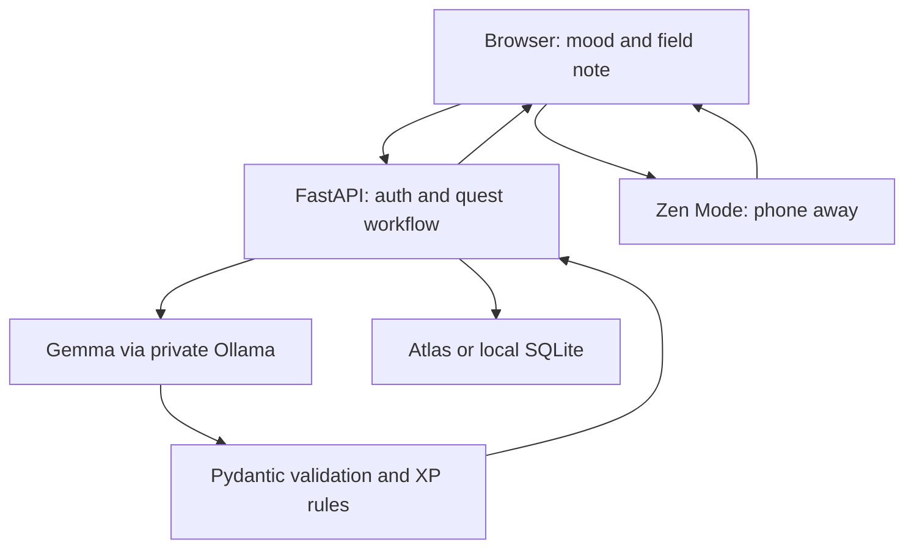

# #HuntingForHappiness 🌿

**A real-world gamified habit breaker. Success means you stop using your screen.**

<!-- Replace with an original photograph or clearly labeled artwork. This is a banner placeholder. -->
<!--  -->

**Banner placeholder:** add your own image at `docs/assets/banner.png` and uncomment the image above. A real outdoor test photo is a strong choice; do not present generated artwork as field-test evidence.

[Demo video — replace](https://www.youtube.com/watch?v=REPLACE_VIDEO_ID) · [Live demo — replace](https://REPLACE_RENDER_SERVICE.onrender.com) · [DEV post — replace](https://dev.to/REPLACE_HANDLE/REPLACE_POST_SLUG)

Built for [Hacktoberfest 2026 Week 1: Touch Grass](https://dev.to/challenges/hacktoberfest-week1-2026-10-05). The code targets **Best Use of Gemma**, **Best Use of MongoDB Atlas**, and **Best Use of Render**. Category claims require an actual tested integration, not this configuration alone.

## What it does

Choose your mood and a five-, ten-, or fifteen-minute window. Gemma chooses an outdoor mission from a curated task catalog. Accept it, and the interface switches to a quiet, dark Zen Mode. Lock your phone and take the mission outdoors. When you return, describe one detail you noticed. Gemma evaluates that reflection against a public rubric; the backend awards bounded XP and saves the completion.

The web app invites you to lock the phone; browsers cannot force the device to lock or prevent other apps from opening. Reflections are self-reported, not verified evidence that a walk happened. This is a low-stakes attention game, not a medical treatment or a location-tracking application.

## Features

- **Zen Mode:** no feed or gamified distractions during the mission; timestamp-based timer survives reloads and phone lock.
- **Open-weight AI Game Master:** real Ollama calls to Gemma for task selection and structured reflection evaluation.
- **Mood and accessibility preferences:** seated observation or a gentle walk; reviewed tasks never require collecting plants, navigation, or wildlife interaction.
- **Reflection first:** short text notes; optional Whisper voice transcription on the backend with transcript review.
- **Server-owned XP:** schema-validated component scores, 20–50 XP per accepted completion, deterministic levels.
- **Retry-safe progress:** one atomic profile update for XP, level, and quest receipt; duplicate submissions return the original receipt.
- **MongoDB Atlas profile:** durable progress, active quests, completed quests, and AI feedback.
- **Local profile:** SQLite + Ollama + FastAPI for fully local processing after installation/model downloads.
- **Offline trail experience:** cached shell, accepted quest, timer, and draft note; submit manually when connected again.
- **Export and deletion:** export your progress JSON or delete your server profile and browser session/draft.
- **Privacy defaults:** no GPS, no photo upload, no third-party browser scripts, no persisted raw reflections by default.
- **Operational basics:** health and readiness endpoints, bounded model concurrency, redacted inference metadata logs, and tests.

## Architecture



The browser and API are served from the same origin. No CORS configuration is necessary. The app uses an anonymous bearer session with a cryptographically random token; only its SHA-256 digest is stored as the profile identifier. There is no client-supplied player ID or XP value.

### File map

| Path | Responsibility |
| --- | --- |
| `backend/main.py` | FastAPI routes, bearer sessions, accept/reflect workflow, voice endpoint, static hosting |
| `backend/gemma.py` | Ollama HTTP calls, schema-constrained output, concurrency limit, latency/token logs |
| `backend/domain.py` | Curated missions, Pydantic contracts, deterministic XP/level rules |
| `backend/store.py` | MongoDB and SQLite adapters, compare-and-swap persistence |
| `frontend/index.html` | Mood selector, quest offer, Zen Mode, reflection and reward screens |
| `frontend/app.js` | API integration, saved timestamps/drafts, optional audio recording |
| `frontend/sw.js` | Static shell caching; never caches API responses |
| `tests/` | Workflow/contracts/concurrency tests; opt-in real Atlas test |
| `Dockerfile`, `render.yaml` | Hosted FastAPI/frontend service |
| `deploy/Dockerfile.ollama` | Separate private Gemma inference service with preloaded weights |
| `docs/DEV_SUBMISSION.md` | DEV draft matching the official submission template |
| `docs/VIDEO_SCRIPT.md` | Two-minute pitch, shot list, filming checklist |
| `docs/IMPLEMENTATION.md` | Endpoint explanation, data/model boundaries, design tradeoffs |
| `docs/SUBMISSION_CHECKLIST.md` | Verified challenge requirements and evidence to fill in |
| `docs/EVALUATION.md` | Real-model rubric cases and measurement protocol |
| `docs/SOURCES.md` | Official challenge and implementation references |

### Two deployment profiles

| Profile | Model execution | Progress storage | Offline behavior |
| --- | --- | --- | --- |
| Local text profile | Ollama on your computer | SQLite on that computer | Full generation/evaluation work without internet after downloads; keep the app and Ollama running |
| Atlas/Render partner profile | Private hosted Ollama reached by Render FastAPI | MongoDB Atlas | Phone retains accepted quest/timer/draft; generation, evaluation, and persistence require backend connectivity |

An accepted mission can travel with a disconnected phone. Gemma is **not bundled into the mobile browser**. If the phone cannot reach the backend, its note remains a draft until you reconnect. Service-worker caching requires HTTPS or localhost and one successful online load. This is not a guarantee of complete installability on every browser; SVG manifest icons may need additional PNG sizes for some platforms.

This repository uses no closed model API. Self-hosting still consumes RAM, compute, and electricity. Render and Atlas may have separate costs. The inference service is a conventional running service, not serverless on-device inference.

## Local setup

### 1. Requirements

- Python 3.12 recommended; a terminal and browser.
- [Ollama](https://ollama.com/download), installed on the same computer.
- Sufficient available memory for the selected model, KV cache, and operating system. Start with Gemma 3 4B on a capable laptop; measure on your hardware. Do not assume a small/free cloud instance can load it.
- MongoDB Atlas URI if using the partner profile. No database account is required for the SQLite profile.

### 2. Prepare Gemma locally

Start Ollama's desktop application, or run this in a separate terminal if no server is running:

```bash
ollama serve
```

Download and warm the configured model:

```bash
ollama pull gemma3:4b
ollama run gemma3:4b "Reply with one sentence about noticing a leaf."
ollama list
```

The default is **Gemma 3 4B**, not the unspecified `gemma`/`latest` alias. Review [Gemma terms](https://ai.google.dev/gemma/terms) before use or redistribution. Save the model ID shown by `ollama list` with your demo evidence. To try another locally installed Gemma model, set `GEMMA_MODEL` to its exact Ollama tag and repeat the evaluation protocol; model quality is not assumed equivalent.

Ollama listens on loopback by default. Do not expose its unauthenticated API publicly. API requests are sent only from the backend to the operator-configured runtime.

### 3. Install the app

From the repository root:

```bash
python -m venv .venv
source .venv/bin/activate
python -m pip install -r requirements.txt
cp .env.example .env
```

Windows PowerShell activation/copy:

```powershell
.venv\Scripts\Activate.ps1
Copy-Item .env.example .env
```

The package has a `requirements-lock.txt` with the versions exercised during package validation. For that version set, install it instead of `requirements.txt`. Optional voice uses a separate dependency file and was not validated with actual audio during package creation.

### 4A. Use MongoDB Atlas

Create a cluster, create a **database user** with read/write access to `hunting_for_happiness`, and allow your current IP in Atlas Network Access. Copy the Drivers connection string. Set these in `.env`:
Use the database user's credentials, not your Atlas website login. URL-encode special characters in the username/password. Keep `.env` out of Git; `.gitignore` already excludes it. TLS defaults for `mongodb+srv` are retained; do not disable certificate validation.

The collection is `players`. MongoDB's built-in unique `_id` index identifies each profile. This small demo deliberately embeds its bounded history in one document for atomic updates. It allows at most 500 successful quests per profile; export before deleting/resetting a full profile. There is no search/embedding index.

### 4B. Use the fully local profile

Replace the database settings in `.env`:

```dotenv
STORAGE_MODE=sqlite
SQLITE_PATH=data/happiness.sqlite3
OLLAMA_URL=http://127.0.0.1:11434
GEMMA_MODEL=gemma3:4b
STORE_REFLECTIONS=false
ENABLE_VOICE=false
```

This profile does not connect to Atlas and does not count as demonstrated Atlas use. After installation, cached frontend assets and downloaded Gemma weights permit a local text workflow without internet. Do not use an ephemeral SQLite file as the hosted progress database.

### 5. Run

```bash
python -m uvicorn backend.main:app --host 127.0.0.1 --port 8000 --reload --no-access-log
```

Open [http://localhost:8000](http://localhost:8000). The API schema is at `/openapi.json`; interactive CDN-loaded documentation is disabled to preserve the same-origin asset policy. Liveness is `/healthz`; `/readyz` checks storage and whether Ollama has the configured model tag. Readiness does not pre-run an inference or promise a latency bound.

For a phone on your home network, binding to `0.0.0.0` makes the server reachable via your computer's LAN IP, subject to your firewall. Plain LAN HTTP generally does not enable microphone access or service workers. Use a trusted HTTPS development setup or the Render deployment for those features. Never publish your bare Ollama port.

## Optional voice reflections

Text reflection works without this feature. Voice uses **Whisper via faster-whisper** on the configured backend; Gemma evaluates the resulting text. It does not use browser cloud speech recognition.

```bash
python -m pip install -r requirements-voice.txt
python -c "from faster_whisper import WhisperModel; WhisperModel('tiny.en', device='cpu', compute_type='int8')"
```

Then set:

```dotenv
ENABLE_VOICE=true
WHISPER_MODEL=tiny.en
WHISPER_OFFLINE=true
```

The one-time warm-up downloads the model. `WHISPER_OFFLINE=true` requires it to exist in the backend user's cache; prepare it under the same OS user that runs the app. `tiny.en` is an English baseline; use an installed multilingual checkpoint and test it if needed. Microphone recording requires HTTPS or localhost and browser permission.

Restart the backend. “Record voice note” appears on the reflection screen. Record at most one minute, stop, review the transcript, then submit. The endpoint caps uploaded bytes, rejects overly long decoded audio, and runs one transcription at a time. The app does not persist the audio.

In local mode audio is processed on your backend computer. On Render it reaches the Render backend, so do not describe that mode as device-private. The standard Dockerfile leaves voice disabled; to host it, install `requirements-voice.txt`, prepare weights in the image/cache for the runtime user, allocate enough memory, and test `/api/transcribe` with an actual browser recording.


## License and credits

Application code: [MIT](LICENSE), copyright 2026 #HuntingForHappiness contributors. Gemma 3 weights: separate [Google Gemma terms](https://ai.google.dev/gemma/terms). Ollama, FastAPI, PyMongo, faster-whisper, and other dependencies retain their own licenses. Model weights and third-party artwork are not included in the package.

The initial code and document package was created with AI assistance; review, real-model evaluation, deployment, and field testing are the maintainer's responsibility. 

**Post-deadline changes:** none recorded in this initial package. If you modify the submitted repository after the deadline, document each change here with date, commit, and description, as required by the challenge FAQ. Verify participant eligibility against the linked rules; a prepared package alone is not a submitted entry.
